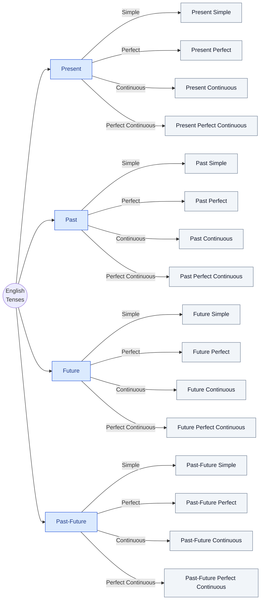

# Introduction

I had 2 years experience of teaching informatics/computer science for junior high school students. After those 2 years, I started to teach English. English was my major, in fact I was majored in English language education for my bachelor and master degrees, but I think I found a critical flaw within myself as an English teacher. A kind of self-doubt, if you will.

A little bit of context, both my father and mother majored in English language education, and so am I. The difference, however, is that my parent learned English through rule-based learning while I learned English implicitly through means of real-life communication and gaming. Because of this, I remember the grammatical rules in English. For instance, I don't remember the formula for Present Perfect Continuous tense. I also don't know what Parts of Speech is. In fact, I have been writing all of my posts, my undergrad. thesis, master thesis, and some scientific paper without explicitly knowing the grammatical rules. I think this has something to do with how I learned the language.

In Second Language Acquisition, there are terms called explicit and implicit learning. Explicit learning is when someone actively and consciously learning the language including its rules, vocabularies, and so on, while implicit learning is when someone passively and unconsciously learning the language. All these years, since I was in the kindergarten until the moment I wrote this article, I was using implicit learning for English, and this brought up problems for me. 

You see, grammar rules like tenses, parts of speech, and the likes were taught in the school. From elementary school, to junior high, and then senior high school; all of the teacher taught me the formula, but I chose to not paid attention whenever it came to English grammar rules. Almost in every English lesson given by the teachers and lecturers, I got a perfect score in all aspects. Vocabulary, perfect. Grammar, almost perfect. Text construction, perfect. In other words, I didn't and I chose not to learn grammar explicitly, but I still aced those exercises and exams. 

Only when I was assigned to teach English to 8th graders did I realize that my grammatical understanding is lacking, in terms of teaching it to the students. I understand how to construct a text, be it descriptive, expository, narrative, so on and so forth; and yet I couldn't explain the why's, the when's, and the how's of using which tenses. As such, when a teacher doesn't possess the mastery of the fundamentals of the materials, the learning outcome(s) is bound to be not achieved.

## The Action

Knowing this fatal weakness, I decided to make a deduction with a systematic approach similar to that of a Data Analyst or Scientist.

### Enumerating the English Tenses

I remember that there are 16 tenses in English, all of which can be categorized into four bigger classification: Past, Present, Future, and Past-Future.

Sixteen (tenses) divided by four (classification) resulted a $4 \times 4$ combination. So, there are **4 tenses in each classification.**

Then, I asked to myself:

> What if the elements in each classification are similar?

To better picture my thoughts, I drew an illustration.

Using this model, we only need to remember or understand as few as 6 nodes.

* Past
* Present
* Future

... for the time dimension; and ...

* Simple
* Perfect
* Continuous

... for the circumstance dimension; and also ...

* Past-Future combination
* Perfect Continuous combination

I do understand that excluding the last two nodes feels like cheating the number to make a "bait" for everyone. But, in my defense, they are just combinations of the existing nodes in each respective dimension. So, it wouldn't occupy much of your brain memory, would it?

### Discussion with Peers

I have some friends who are willing to discuss with me about English. They are my classmates. And, funily enough, one of them had the same problem with me. She realized that a portion of her knowledge about English grammar is based on "feelings" rather than the rule itself. Therefore, we discussed from the very foundation of the English language, the Parts of Speech. Luckily, she was a teaching assistant in a university in 2022, and she still have some General English materials saved in her device's storage.

When I was trying to comprehend the Parts of Speech, something came up to my mind. A refletive question for myself.

> I learned English implicitly and thus I couldn't teach English maximally; do teachers who learned implicitly also struggle to teach what they learned?

[To answer this question, I prepared a mini research, which is elaborated in a different section](#self-study).

### Self-study

For the past few years, especially since the COVID-19 pandemic emerged globally, my learning style had shifted quite radically. I went from instructor-led learning to self-paced learning. I felt the effectiveness of self-paced learning significanly inclining after I learned (1) Google Dorking technique from a cybersecurity bootcamp on Q2 2025, and (2) started playing Arknights: Endfield on Q1 2026, where the latter being the most impactful catalyst that shaped my engineering mindset.

You might wonder the correlation between learning style and engineering mindset I mentioned earlier. Well, there is a reciprocal relationship between the two. First, I see engineering as a state of mind rather than a formal education faculty. This means that engineering mindset is not exclusive to those who studied engineering, anyone who is crafty and curious enough can have this mindset, and so I believe. With this engineering mindset that I developed from playing Arknights: Endfield, I constantly thinking of ways to circumvent all kinds of problem, including "engineering" the way I learn. [In educational sciences, this experience is recognized as meta-cognition](). It is the ability when someone thinks about thinking. In other words, I hacked my own brain to learn faster by using meta-cognition.

As of the writing of this article (2026-10-27 22:06:00 +0700), I have learned half of the Parts of Speech.